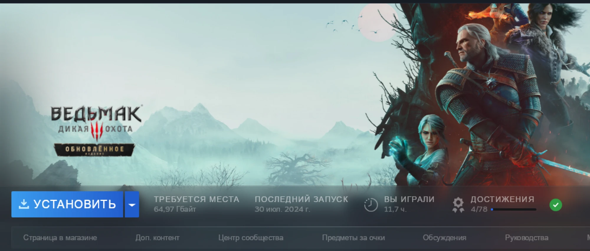
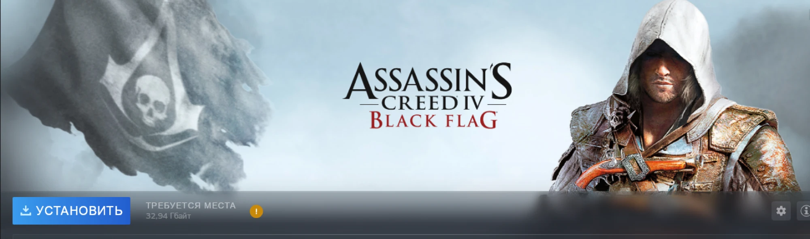
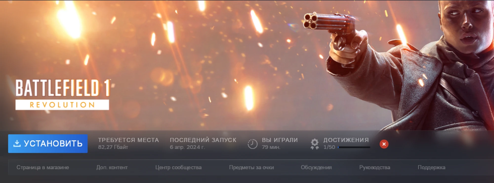

# mapc-compat

Плагин [Millennium](https://github.com/SteamClientHomebrew/Millennium) для Windows-версии Steam, которая работает на macOS под Wine через MaPC. На странице игры в библиотеке, в строке статистики рядом с кнопкой «Установить» или «Играть», он показывает цветной значок: стоит ли вообще пробовать эту игру на Mac.





## Значки

Значок это цветной круг 22 px с белой иконкой. При наведении всплывает подсказка: первая строка это название вердикта, дальше по строке на каждую причину в виде `источник: текст`.

| Значок | Вердикт | Смысл |
|---|---|---|
| зелёная галочка | Пойдёт | препятствий не найдено, отзывы о запуске хорошие, железо тянет |
| синяя галочка | Есть для Mac | есть родная версия, лучше ставить её через обычный Steam для Mac |
| жёлтый восклицательный знак | С оговорками | скорее запустится, но есть минусы: средние отзывы, железо на грани, античит |
| красный крест | Не пойдёт | античит, который не работает под Wine, или отзывы, что игра не запускается |
| серый вопросительный знак | Неизвестно | данных не хватило, плагин не делает вид, что знает |
| серые точки | Проверяю | данные ещё грузятся |

## Как принимается решение

Данные берутся из четырёх источников: Steam (`appdetails`: платформы и системные требования), AppleGamingWiki (оценки Wine и CrossOver), AreWeAntiCheatYet (античиты), ProtonDB (отзывы, только когда AppleGamingWiki молчит; это данные про Linux, сигнал слабый).

Порядок такой: родная версия для Mac, потом античит, потом оценки AppleGamingWiki, потом ProtonDB. Системные требования сравниваются с профилем вашего Mac и могут только понизить вердикт, например с «Пойдёт» до «С оговорками». Нет данных ни в AppleGamingWiki, ни в ProtonDB: «Неизвестно». Ответы кэшируются, повторное открытие игры не ходит в сеть.

## Установка Millennium в MaPC

Пути ниже для бутылки `steam` в MaPC.

1. Закройте Steam.
2. Скачайте со [страницы релизов Millennium](https://github.com/SteamClientHomebrew/Millennium/releases) архив `millennium-<версия>-windows-x86_64.zip` и файл `.sha256` к нему. Проверено на версии 3.6.2. Сверьте сумму: `shasum -a 256 millennium-*.zip`.
3. Распакуйте архив в папку Steam внутри бутылки:
   `~/Library/Application Support/MaPC/Bottles/steam/drive_c/Program Files (x86)/Steam`.
   Появятся `wsock32.dll` (прокси-библиотека) и папка `millennium`.
4. Добавьте в реестр бутылки запись, чтобы Wine грузил этот `wsock32.dll`, а не свой. Путь к Wine зависит от версии движка MaPC, посмотрите её в `~/Library/Application Support/MaPC/Engines/` (у автора 1.0.1):

   ```sh
   WINEPREFIX="$HOME/Library/Application Support/MaPC/Bottles/steam" \
   "$HOME/Library/Application Support/MaPC/Engines/<версия движка>/Wine Staging.app/Contents/Resources/wine/bin/wine" \
   reg add 'HKCU\Software\Wine\DllOverrides' /v wsock32 /d native,builtin /f
   ```
5. Запустите Steam через MaPC. Millennium покажет окно приветствия, в Steam появятся его настройки, а в папке Steam будет `millennium/plugins`.

## Установка плагина

Нужен [bun](https://bun.sh).

```sh
git clone https://github.com/dxoraxs/mapc-compat.git
cd mapc-compat
bun install
bash scripts/install.sh
```

Скрипт собирает плагин и копирует его в `~/Library/Application Support/MaPC/Bottles/steam/drive_c/Program Files (x86)/Steam/millennium/plugins/mapc-compat/`. Перезапустите Steam, откройте настройки Millennium, включите плагин `mapc-compat` и перезапустите Steam ещё раз, если он попросит.

Сеть плагин использует только из Lua-части, и только четыре хоста: `store.steampowered.com`, `www.applegamingwiki.com`, `raw.githubusercontent.com`, `www.protondb.com`.

## Настройки

Изнутри Wine плагин не видит настоящее железо, поэтому профиль Mac задаётся вручную: страница плагина в настройках Millennium. Поля: чип, ядра GPU, память в ГБ, кнопка «Сбросить кэш». По умолчанию стоит профиль автора (Apple M5 Pro, 20 ядер GPU, 48 ГБ).

Таблица «чип Apple, примерный уровень видеокарты» грубая. Это оценка с поправкой на потери трансляции, а не измерение: подсказка прямо пишет «примерно как RTX …». Относитесь к проверке железа как к ориентиру.

## Логи

Все сообщения плагина попадают в `Steam/logs/webhelper_js.txt` внутри бутылки (`~/Library/Application Support/MaPC/Bottles/steam/drive_c/Program Files (x86)/Steam/logs/webhelper_js.txt`) и начинаются с `[mapc-compat]`:

```sh
grep '\[mapc-compat\]' "$HOME/Library/Application Support/MaPC/Bottles/steam/drive_c/Program Files (x86)/Steam/logs/webhelper_js.txt"
```

## Удаление

Закройте Steam и удалите папку плагина `.../Steam/millennium/plugins/mapc-compat`. Чтобы убрать и сам Millennium, удалите из папки Steam `wsock32.dll` и папку `millennium`, а запись в реестре снимите:

```sh
WINEPREFIX="$HOME/Library/Application Support/MaPC/Bottles/steam" \
"$HOME/Library/Application Support/MaPC/Engines/<версия движка>/Wine Staging.app/Contents/Resources/wine/bin/wine" \
reg delete 'HKCU\Software\Wine\DllOverrides' /v wsock32 /f
```

## Благодарности

Подход (значок в строке статистики, сеть через Lua, поиск классов Steam через `findClassModule`) подсмотрен у [nyakuoff/protondb-badge](https://github.com/nyakuoff/protondb-badge). Код оттуда не копировался.

## Лицензия

[MIT](LICENSE)
